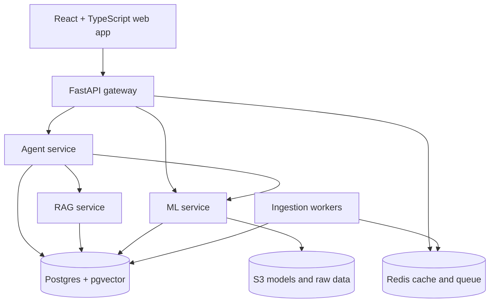

# Architecture

## Components
| Component | Responsibility |
|---|---|
| `web` | React/TypeScript chat UI, live win-probability chart, eval dashboard |
| `api` | FastAPI gateway: auth, rate limits, response caching, routing to services |
| `agent` | Planner/router loop, tools (SQL, chart, RAG, ML), guardrails, tracing |
| `rag` | Document ingestion, chunking, hybrid retrieval, reranking, citations |
| `ml` | Training pipelines, model registry (S3), inference endpoints |
| `ingest` | Scheduled and queued jobs that load play data and documents |
| `evals` | Golden questions, retrieval/ML benchmarks, regression gate |
| Postgres + pgvector | Play data, metric registry, schema descriptions, doc chunks, eval results |
| Redis | Cache, rate-limit counters, RQ job queue |
| S3 | Model artifacts, raw data snapshots |

## Diagram

## Request flows
**Ask a question**
1. Web sends `POST /v1/agent/ask` through the gateway (auth, rate limit, cache check).
2. Agent retrieves relevant metric definitions and schema descriptions from pgvector.
3. Planner chooses tools: SQL, RAG, ML, or a combination. It may loop and re-plan, up to a step limit.
4. SQL tool runs validated read-only queries. RAG tool returns cited chunks. ML tool returns predictions.
5. Agent composes a grounded answer (citations, SQL used, chart spec, confidence). Every step is traced.

**Live win probability (replay mode)**
1. Client opens `WS /v1/games/{id}/replay`.
2. Server streams plays at real-time speed, calls the win-probability model per play, caches game state in Redis, and emits probability updates plus anomaly flags.

**Ingestion**
1. A scheduled job enqueues load tasks in Redis (RQ).
2. Workers load data idempotently into Postgres, then chunk and embed documents.

## Trade-offs to document (fill in `DECISIONS.md`)
- Postgres + pgvector versus a separate vector database: one system to run and join against, at some cost in vector-search scale.
- Hybrid retrieval versus vector-only: better recall on names and exact terms, more moving parts.
- Cache invalidation: what goes stale when ingestion runs, and how keys are versioned.
- Gateway calling ML directly versus via the agent: lower latency for live views.
- Denormalizing season/week onto plays: faster filters, more storage.

## Scaling notes (for interview discussion, not v1 work)
- Read replicas for the analytics workload.
- Partitioning plays by season.
- Moving embeddings to a dedicated vector store.
- Async job workers scaled horizontally.
